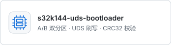
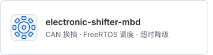
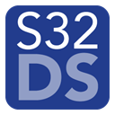
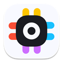

# 徐创 · XU CHUANG

`嵌入式软件工程师` · `2027 届` · `汽车电子 / 车载网络`

> —— 先从让每一帧 CAN 报文准时到达开始。

2027 届本科应届，**南京工业职业技术大学 · 汽车服务工程**。在 **NXP S32K144 / STM32G474** 上写 C：Bootloader、UDS 诊断、CAN 通信、FreeRTOS 调度。比起调界面，我更愿意盯着示波器和 CANoe 的 trace，找那个丢掉的字节。

<a href="https://github.com/koko-PhyuHtwe/s32k144-uds-bootloader"><picture><source media="(prefers-color-scheme: dark)" srcset="./assets/cards/tile-boot-dark.svg"></picture></a><a href="https://github.com/koko-PhyuHtwe/electronic-shifter-mbd"><picture><source media="(prefers-color-scheme: dark)" srcset="./assets/cards/tile-shifter-dark.svg"></picture></a>

&nbsp;

 
CAN 2.0B · UDS ISO 14229 · ISO 15765-2 · FreeRTOS · Simulink / Stateflow / Embedded Coder · CANoe / CAPL

